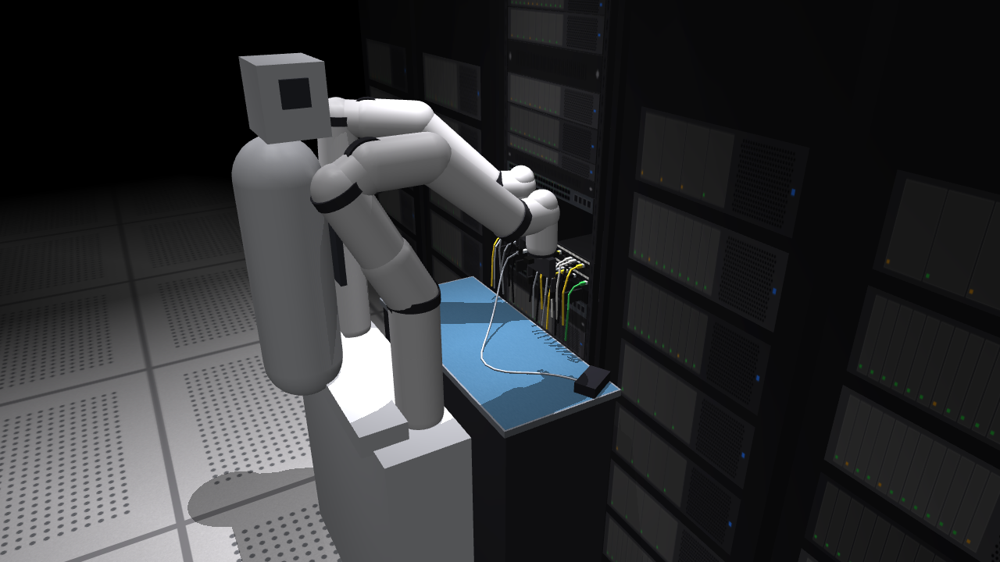

# Robot Plugging Sim

A MuJoCo simulation of the WR1 data-center task, **a bimanual robot picking an RJ45 patch cable off
a shelf and plugging it into a patch panel**, built as a controllable, labelled data source for
the lab's projects: world-model failure monitors, latent steering, test-time adaptation and
failure-aware recovery.



* **A data-center aisle**: a 19" rack with 2 × 24-port patch panels (numbered labels, colour-coded
  cables in occupied ports), a top-of-rack switch, servers, cable managers, neighbouring racks, a
  raised floor, ceiling lights and a cable tray. The pose, occupancy, lighting and clutter are
  randomised per episode.
* **22 OOD shifts** in four groups: lighting (dim, harsh, coloured, flicker); appearance (cable/boot/
  panel colour, clutter, distractor cable, dense panel, LED distractors); sensor (camera shift,
  noise, motion blur, overexposure, lens occlusion); physics (heavy/stiff cable, slippery gripper,
  rack offset, arm-gain drift, weak gripper).

* **Same format as the real Bimanual Cable Manipulation data**: `episode.parquet` (ns timestamps,
  `observation.state`, `action`) and one mp4 per camera, so `GaugeFailClassification` loaders work on it.
* **Success / known-failure / OOD** episodes with separate *injected* and *physical* labels and
  event times (drop, latch, injection).
* **Exact save/restore** of the full simulator + controller state: counterfactual branching from
  any recorded step (e.g. the RQ1 oracle test: execute K candidate chunks from the same state).
* Plain MuJoCo, primitives only, no plugins. Runs on a Mac; scales over CPU cores on GPU nodes
  (EGL rendering), and the model stays MJX/MuJoCo-Warp-friendly.

Everything rests on **strong placeholder assumptions** (no CAD, gripper or kinematics for WR1
yet). They're all in [plugsim/config.py](plugsim/config.py) and listed in
[ASSUMPTIONS.md](ASSUMPTIONS.md).

## Quick start

```bash
git clone https://github.com/carlo-scr/RobotPluggingSim.git && cd RobotPluggingSim
uv venv --python 3.11 .venv && uv pip install --python .venv/bin/python -e ".[learn,notebooks,dev]"
.venv/bin/python -m pytest -q tests                      # ~15 s smoke test
.venv/bin/python notebooks/build.py --execute            # (re)build + run the notebooks
.venv/bin/python scripts/generate_dataset.py --out data/smoke --n 20 --workers 4
```

On a headless GPU node: `MUJOCO_GL=egl python scripts/generate_dataset.py --out /scratch/plugsim/v0 --n 20000 --workers 90`
(see notebook 04 for sharding, config overrides and throughput).

```python
from plugsim.env import PlugEnv
from plugsim.expert import ScriptedExpert
env = PlugEnv(); env.reset(seed=0)
ex = ScriptedExpert(env, seed=0)                  # privileged "teleoperator"
while not ex.done:
    obs = env.step(ex.act())                      # 16-D action, 44-D proprio state
img = env.render("right_gripper_front")
snap = env.get_state(); env.set_state(snap)       # exact restore
```

## Notebooks

| | |
|---|---|
| [00_scene_and_assumptions](notebooks/00_scene_and_assumptions.ipynb) | scene, cameras, assumptions, cable-layout and OOD randomisation |
| [01_insertion_physics](notebooks/01_insertion_physics.ipynb) | jack/chamfer/latch model, funnel maps (compliant vs stiff), clearance sweep, force profile, determinism |
| [02_expert_demos](notebooks/02_expert_demos.ipynb) | scripted expert, nominal success, phase timeline, video |
| [03_failures_and_ood](notebooks/03_failures_and_ood.ipynb) | 7 failure types × severity outcome matrix, 7 OOD shifts, failure gallery |
| [04_dataset_generation](notebooks/04_dataset_generation.ipynb) | parallel generation, on-disk format, loader compatibility, counterfactual branching, H100 scaling |
| [05_policy](notebooks/05_policy.ipynb) | Diffusion Policy (state or image) trained on DART demos; closed-loop eval vs the expert |
| [06_world_model_monitor](notebooks/06_world_model_monitor.ipynb) | encoder (conv AE or Cosmos) + probabilistic latent WM; conformal failure monitor; three-way decision |
| [07_steering](notebooks/07_steering.ipynb) | RQ1 oracle ranking from saved states, best-of-K steering, conformal abstention, Learn-then-Test |
| [colab_runner](notebooks/colab_runner.ipynb) | runs 05–07 on a Colab A100 with the `a100` preset (data/checkpoints on Drive) |

Notebook sources live in `notebooks/src/*.py` (percent format) and are built with `notebooks/build.py`.
Scale presets via `PLUGSIM_SCALE=local|a100|h100`; `PLUGSIM_OBS=state|image` selects the policy observations.

### Training on a Colab A100 (incl. VS Code connected to a Colab runtime)
Every notebook starts with a setup cell that, on a Colab runtime, fetches the code (the VM can't
see your local files), `pip install`s it, sets `MUJOCO_GL=egl`, and picks the `a100` preset when a
GPU is present. It keeps `data/` and `runs/` on Drive (`MyDrive/plugsim_runs/`) when Drive is
mounted. Ways to get the code onto the VM, tried in order:

1. **git** (default): clones this repo (`PLUGSIM_REPO` at the top of the setup cell), and pulls on later runs.
2. **zip**: `bash scripts/make_colab_zip.sh` makes `../RobotPluggingSim.zip` (~160 KB); upload it
   to `/content/` on the runtime.
3. **Drive**: put the folder at `MyDrive/RobotPluggingSim` (needs `drive.mount`, which may not work
   in every client).

Then run 05 → 06 → 07 in order (07 loads the policy from 05 and the encoder from 06). Alternatively,
`notebooks/colab_runner.ipynb` runs all three headless and saves the executed notebooks to Drive.

## Images and videos

`scripts/render_gallery.py --out media/gallery` renders the scene gallery:
[hero shots](media/gallery/), patch-panel close-ups at three occupancy levels, all robot cameras,
the lighting shifts and the full OOD gallery (`ood_gallery.png`), plus videos:

| video | what |
|---|---|
| `tour.mp4` | dolly along the rack row, then reveal the robot working |
| `orbit.mp4` | camera sweep around an expert episode, zooming into the insertion |
| `robot_pov.mp4` | head, chest and gripper cameras through a full episode (what policy/WM see) |
| `dense_insertion_closeup.mp4` | low close-up of an insertion into a nearly full panel |
| `failures_montage.mp4` | every known failure type, cut around the moment it shows |
| `conditions_grid.mp4` | the same episode under 6 lighting/sensor conditions, synchronised |
| `ood_montage.mp4` | 12 visual OOD conditions (head + gripper camera) |
| `counterfactual_branches.mp4` | one saved state, 4 continuations with growing alignment error (the RQ1 oracle mechanism) |
| `policy_rollouts.mp4` | the learned Diffusion Policy: a success next to a failure |

`scripts/render_videos.py --out media` renders showcase clips into [media/](media/). Each frame is a
2×2 mosaic: third-person, port close-up, and the active gripper's two cameras, with a time / phase /
depth / latch overlay. Each clip also gets a 6-frame contact sheet (`.png`).

| clip | what |
|---|---|
| `nominal.mp4`, `nominal_left.mp4` | pick → re-orient → align → compliant insert → latch (right / left arm) |
| `jam_retry.mp4` | nominal episode with a jam on the jack lip, recovered by back-off + spiral retry |
| `drop.mp4` | known failure: cable dropped during transport |
| `misalign.mp4` | known failure: biased port estimate, plug jams on the jack |
| `partial_insert.mp4` | known failure: released before the click, pops back out |
| `wrong_port.mp4` | known failure: plugged into the neighbouring port |
| `ood_lighting_distractors.mp4` | OOD: dim lighting + clutter |
| `ood_dense_ports.mp4`, `ood_colored_light.mp4`, `ood_sensor.mp4`, `ood_rack_offset.mp4` | more OOD conditions |

## Layout

```
plugsim/
  config.py      every assumption (dataclasses)
  scene.py       procedural MJCF: rack/panel/jacks, cable chain + plug, 2 arms + grippers, cameras
  env.py         PlugEnv: IK controller, compliant mode, latch, privileged state, render, get/set_state
  scenario.py    per-episode randomisation (cable layout, DR) + OOD shifts
  expert.py      scripted expert with closed-loop alignment, compliant insertion, jam retries
  failures.py    known-failure injection specs
  datagen.py     rollout + labelling (+ DART noise) + export/load + restore
  textures.py    procedural textures (labels, server/switch fronts, rails, floor tiles)
  tools.py       notebook helpers (grids, video, branching)
  learn/
    data.py      episode loading, task features, normalisers, splits
    policy.py    Diffusion Policy (U-Net, DDIM), training, closed-loop runner
    encoders.py  conv autoencoder / Cosmos tokenizer adapter
    wm.py        probabilistic latent WM ensemble (Ward et al. / dnh ProbWM)
    monitor.py   conformal monitor, detection metrics, three-way decision
    steer.py     scorers, best-of-K / tilted steering with abstention, RQ1 ranking, Learn-then-Test
scripts/generate_dataset.py   multiprocess dataset generation (--dart for policy demos)
scripts/render_videos.py      showcase videos + contact sheets -> media/
scripts/render_gallery.py     stills, orbit and OOD montage -> media/gallery/
tests/test_smoke.py
```

## Status (v0.2)

* Nominal scripted expert: 80/80 seeds latched in the v0.2 scene (2 × 24-port panel with occupied
  neighbours, rack pose jitter, clutter); ≈1 % of episodes need a jam retry.
* Learned Diffusion Policy (state obs, `a100` preset: 4,000 DART demos, 60k steps): **76 %** success
  on 50 held-out scenarios, vs **98 %** for the privileged expert on the same scenarios
  (laptop preset: 25 %).
* Restore + replay of recorded actions: bit-exact (max state deviation 0.0).
* ≈ 2 s per episode physics-only and ≈ 8 s with 4 cameras per CPU core on an M-series Mac. About 2 MB per episode.

## Next

1. Swap in real WR1 numbers as they arrive (kinematics, gripper, camera poses, state/action layout).
2. Scale 05–07 on the A100/H100 presets (image-based policy, Cosmos latents, LTT with enough
   calibration episodes).
3. Cable routing through the cable managers (currently visual-only) and unplugging tasks.
4. Optional: MJX / MuJoCo-Warp batch rollouts for physics-only counterfactual scoring on GPU.
